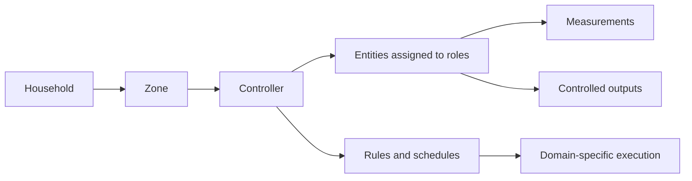

# Zones, controllers, entities and rules

A controller is the starting point for a meaningful automation. The app uses its existing domain tabs, zone navigation, controller pads and side panel for watering, lighting, humidity, power and cleaning.

## The model

A **zone** is a user-defined scope: a room, part of a garden, or another logical grouping. Imported Home Assistant areas provide suggestions. They do not decide what a plug powers or silently reassign a controller. A controller has one explicit zone; its entities can be located elsewhere. Several controllers of the same or different purposes can share a zone.

A **controller** records the user's intent and the relationship between entities. A Zigbee plug assigned to the role “powers the dehumidifier” is part of a humidity controller even though its technical HA domain is `switch`. Device capabilities determine which assignments can execute; the chosen controller purpose determines their meaning.

A **rule** belongs to a controller and defines when or under which conditions it acts. It reuses the controller's entities. Changing thresholds, weekdays or times does not require choosing the devices again. Measurements may be shared by several controllers. Rules that compete for the same outputs cannot be active together in this release.

| Controller purpose | Entity meaning | Current rule behavior |
| --- | --- | --- |
| Watering | Valve/pump outputs and soil-moisture measurements, plus plants | Existing schedule, watering duration and moisture condition |
| Humidity | Outputs powering dehumidifiers, with a room-humidity measurement | Two humidity thresholds, optional time window, cycle protection and stale-measurement handling |
| Lighting | One or several outputs making up the intended lighting group, including a plug powering a lamp | Time window and optional brightness for compatible outputs |
| Power | Outputs powering user-selected appliances | Time window |
| Cleaning | One or several supported vacuum entities | Cleaning start time and weekdays |

Lighting currently supports scheduled switching and dimming. Presence and illuminance conditions are not implemented. They should be added as typed measurement roles and rule behavior on the lighting controller, using the same editor and navigation. A sensor's presence alone never implies an executable policy.

## The UI flow

1. Choose a domain and zone, or create a zone in the zone menu.
2. Create a controller, name its purpose, confirm the zone, and assign entities to their roles. HA area matches are shown as suggestions; devices in other rooms remain selectable.
3. Open **Edit Rules** on its pad. Add a rule, preview it, save the draft, and activate separately.
4. Use **Edit Controller → Entities & Roles** to inspect live values or change assignments. Pause deployed rules and wait for local confirmation before replacing their entities.

The root route is the controller dashboard again. The device inventory and connection settings are supporting pages under `/devices` and `/connections`. Domain, zone, controller and panel selection are represented in the URL; a reload or browser navigation restores that context. `/watering` remains compatible with the previous entry point.

## Storage and compatibility

PostgreSQL migration `002_controller_zones.sql` introduces persistent zones and controllers. Every saved HA automation has a non-null, household-bound controller reference. Existing drafts/deployments receive a controller without changing their rule ID, parameters, version or deployment intent. The migration itself sends no device commands.

The existing watering controller and scheduler APIs retain their data and execution semantics. Their zones are included in the same navigation. The new domains implement the same domain/zone/controller route structure; watering is not embedded inside a separate automation application.

Old automation API clients without a controller ID are supported by creating a controller as part of saving their first rule. The new UI always creates or opens the controller first. Editing a rule cannot move it to a different controller or override its entity bindings. An explicitly supplied controller must belong to the authenticated household.

Controller assignment changes update its draft rules transactionally, preserving rule IDs and incrementing versions. Active or unconfirmed local rules block reassignment. Renaming or changing the zone does not change rule inputs. A controller cannot be removed until removal of its rules has been confirmed locally. Moving to a different HA connection requires removing previously deployed rules first.

Watering still executes through its existing central scheduler; the other implemented templates execute locally in HA. Sharing a conceptual controller model does not erase domain-specific runtime behavior. A later migration of the watering runtime requires a separate implementation and acceptance check.

## Verification

The controller checks cover user-defined zones, entity roles, household and viewer isolation, rule/controller binding validation, draft propagation, stale edits, active/pending reassignment guards, filtered rule history, incompatible device roles, and migration preservation. Browser checks cover a humidity controller and a newly created lighting controller, including saving a child rule and reloading its direct URL.

All device interaction during development uses the isolated local preview and simulated entities. Deployment against a real HA installation remains to be checked separately.
